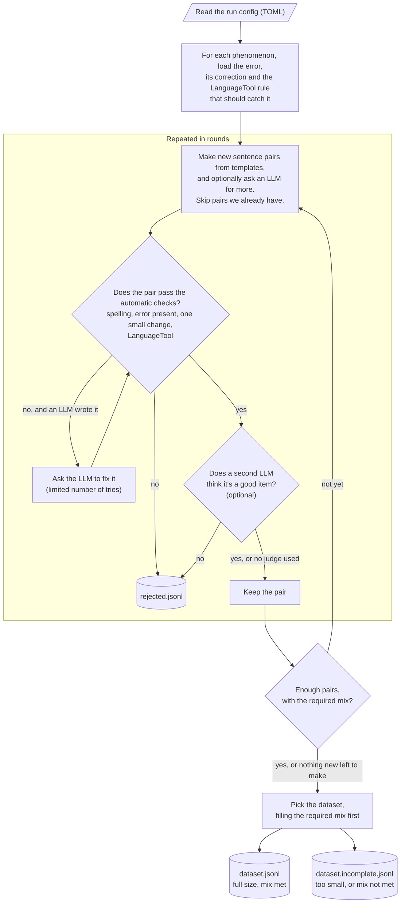

# rauxa

Generator of verifiable Catalan language tasks, built to produce benchmarks (and training
data) that target **normative Catalan**: Spanish calques, elision and contraction, weak
pronouns, diacritics...

Two layers:

1. **Procedural generator** with a reasoning-gym compatible interface. Items are built from
   templates and rules, so the gold answer is correct by construction. No LLM involved.
2. **Pipeline**: makes candidate pairs (from the procedural generator and, optionally, an LLM
   *writer*), runs automatic checks and an optional LLM *judge*, and selects a dataset that
   meets minimum shares per phenomenon and format. LLMs only suggest pairs or give opinions;
   the code decides what is kept.

## Getting started

[GETTING_STARTED.md](GETTING_STARTED.md) walks you from a fresh clone to a finished dataset:
setup, starting LanguageTool, running the pipeline, reading the results, changing the config,
adding LLMs and using the dataset. The short version, with LanguageTool already running on
port 8081 ([how to start it](GETTING_STARTED.md#2-start-languagetool)):

```bash
python3 -m venv .venv && source .venv/bin/activate && pip install -e .
rauxa run configs/castellanismes_procedural.toml
rauxa summary out/runs/castellanismes_procedural
```

## Procedural generator

```python
import rauxa

data = rauxa.create_dataset("castellanismes_verbals", size=10_000, seed=42, formats=("mcq", "gec"))
entry = data[0]
entry["question"]   # prompt in Catalan
entry["answer"]     # gold answer
entry["metadata"]   # phenomenon, tense, sentence_good / sentence_bad, accepted variants...
data.score_answer("A", entry)  # 0.0 or 1.0
```

| reasoning-gym | rauxa |
|---|---|
| Config dataclass with `validate()`, `seed`, `size` | Same (`CastellanismesVerbalsConfig`, ...) |
| `ProceduralDataset`, item `idx` built with `Random(seed + idx)` | Same: any item is regenerable from its index |
| Item `{question, answer, metadata}` | Same; metadata always carries `sentence_good` / `sentence_bad` |
| Answer computed in code | Correct sentence realised by `rauxa.catalan` (conjugation, elision, contractions) |
| `score_answer` verifier | Per-format verifiers (`rauxa.formats.score`) |
| `register_dataset` / `create_dataset` / `get_score_answer_fn` | Same names |
| `BaseCurriculum` | Simplified version with scalar attribute levels |

Each pair renders in one of three formats: `mcq` (pick the correct sentence), `judgement`
(is it correct? sí/no) and `gec` (correct it). Every item also exports as a BLiMP-style
minimal pair for log-likelihood scoring.

## Pipeline



### Automatic checks

| Check | Passes when |
|---|---|
| `schema` | Required fields present; the correct sentence is among the accepted variants |
| `orthography` | No unelided *de*/article/pronoun, no missing contraction, capitalised, final punctuation |
| `marker` | The phenomenon's regex matches the incorrect sentence and no correct variant |
| `minimal_pair` | The two sentences differ by one contiguous edit of at most `max_edit_tokens` tokens |
| `languagetool` | Every correct variant gets no LanguageTool match. If the incorrect sentence is not flagged, that is recorded as a case LanguageTool misses; it only rejects with `require_bad_flagged` |

### Run directory

| File | Meaning |
|---|---|
| `dataset.jsonl` | The dataset: target size reached and every minimum share met |
| `dataset.incomplete.jsonl` | Written instead when there are too few pairs or a minimum share is not met |
| `candidates.jsonl` | Every pair made, before any check. Don't use it as a dataset |
| `checks.jsonl`, `judge.jsonl` | Per-pair check results and judge verdicts (append-only, used to resume) |
| `rejected.jsonl` | Pairs that were dropped, with the reason |
| `manifest.json` | Config and fingerprint, counts, check failures, LanguageTool flag rate and misses per phenomenon, judge stats, shares, warnings |
| `state.json` | Resume state. `rauxa run CONFIG --resume` continues an interrupted run; a changed config is refused |

Every kept pair carries `metadata.qc` with how it was kept (`judge: not_used | passed | audited |
not_sampled | error`, `kept_despite_judge_error`), its check results and LanguageTool details.

### Safeguards

- **Judge errors are handled explicitly**: `on_error = "reject" | "keep"`, recorded on each pair
  and counted in the manifest.
- **Same-family bias**: the manifest warns when the judge is from the same model family as the
  LLM writer, or either is from the same family as a model in `evaluated_models`.
- **Checking the judge**: `rauxa review` collects native-speaker labels; `rauxa calibrate`
  reports judge–human agreement and Cohen's kappa, and how many pairs that passed the automatic
  checks a human would still reject.
- **Running out of pairs**: a procedural source that stops producing new unique pairs is marked
  exhausted and reported, instead of silently repeating pairs.

### LLM backends

The writer and the judge use any OpenAI-compatible chat endpoint (OpenAI, vLLM, Ollama,
llama.cpp server...). Keys are read from the environment variable named by `api_key_env`; local
servers need none. See [configs/castellanismes_full.toml](configs/castellanismes_full.toml).

### Without an API: a coding agent plays the LLM roles

With `type = "agent"` backends, each LLM call is written to
`agent_exchange/requests/<id>.md` and the run stops with status `waiting` (exit code 3). A
coding agent such as Claude Code or Codex answers each request in `responses/<id>.json`, and
`rauxa run CONFIG --resume` continues. Everything except the LLM answers runs as normal, with
the same prompts as an API run. Open the repo in your agent and ask it to follow
[AGENT_PIPELINE.md](AGENT_PIPELINE.md); the config is
[configs/castellanismes_agent.toml](configs/castellanismes_agent.toml).

## Command reference

```bash
rauxa list                                                   # available tasks
rauxa run configs/castellanismes_procedural.toml             # pipeline, no LLM
rauxa run configs/castellanismes_full.toml                   # + LLM writer and judge
rauxa run configs/castellanismes_agent.toml [--resume]       # LLM roles played by a coding agent
rauxa summary out/runs/castellanismes_procedural             # results of a run
rauxa generate castellanismes_verbals --size 1000 -o out/raw.jsonl   # generator only
rauxa review out/runs/castellanismes_procedural/dataset.jsonl out/labels.jsonl --n 100 --reviewer your-name
rauxa calibrate out/labels.jsonl out/runs/castellanismes_procedural
rauxa export-lm-eval out/runs/castellanismes_procedural/dataset.jsonl out/lm_eval --name rauxa_cv
python scripts/preview_pairs.py castellanismes_verbals 30    # template pairs, for a quick look
```

Every command takes `--help`. Without installing, run `export PYTHONPATH=src` and use
`python3 -m rauxa` in place of `rauxa`.

## Tasks

| Task | Phenomena |
|---|---|
| `castellanismes_verbals` | `tenir_que` (→ *haver de*), `hi_ha_que` (→ *cal* / *s'ha de*), `donar_se_compte` (→ *adonar-se*) |

Only the IEC (central) norm is implemented; `norm="avl"` raises `NotImplementedError`.

## Tests

```bash
python -m unittest discover -s tests
```
